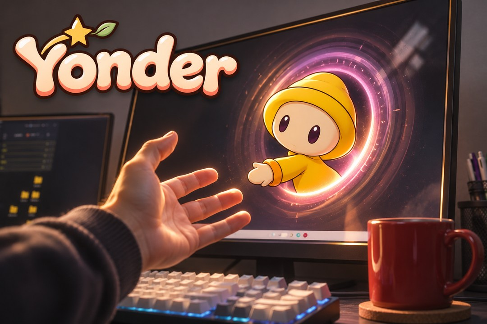

# Yonder

**An AI teammate that moves between your desk and your screen and builds the tools you ask for.**

I built Yonder for the days I spend working alone. I can hold up my coffee mug so Nilo sees what I mean, ask him to make a 3D copy, and open that same model on my computer. When I need a new tool, I can describe it out loud and put it to work during the same session.

## Download and play

The demo uses **two apps**. The Quest app puts Nilo in your room. The Windows companion lets him cross onto your desktop and work with your files and windows.

| Device | Download | Getting started |
| --- | --- | --- |
| **Meta Quest 3 or 3S** | [Download Yonder for Quest (.apk)](https://github.com/PinousCEO/MetaVR_Hack/releases/download/yonder-0.1.0/Yonder-Quest.apk) | Install through the competition release channel if you have an invitation, or sideload this APK on a developer-enabled headset. |
| **Windows x64 PC** | [Download Yonder Companion Setup (.exe)](https://github.com/PinousCEO/MetaVR_Hack/releases/download/yonder-0.1.0/Yonder-Windows-Setup.exe) | Run the installer, then open **Yonder Companion** from the Windows Start menu. The package includes the host, desktop character and .NET runtime. |

[Release notes and SHA-256 checksums](https://github.com/PinousCEO/MetaVR_Hack/releases/tag/yonder-0.1.0) · [MacBook setup](Companion/LivingPartner.Mac/README.md)

### Connect your desk

1. Put the PC and Quest on the same local network. Start **Yonder Companion** on the PC and allow it through Windows Firewall on your private network.
2. Open **Yonder** in the headset. For the first wireless connection, enter the six-digit code displayed by the PC companion. Give Yonder access to the headset camera for monitor and object recognition, and the microphone for voice.
3. Glance at each monitor when it lights up so Yonder can locate the display in your room. After moving a screen, use **Calibrate** in the hand menu or say **“Hey, Nilo, find my screens.”**
4. Point at a spot on the monitor and send Nilo inside. Watch his feet as he crosses the glass. Try a game of tennis and return his serve with your hand.

**Sideloading by USB:** With Android platform tools installed and USB debugging authorized in the headset, run the following from the folder containing the APK. Once the app is installed, the two devices can pair over Wi-Fi.

~~~powershell
adb install -r Yonder-Quest.apk
~~~

The competition APK is release-signed. If you previously installed the developer-signed demo, Android will reject an in-place update because the signatures differ. Back up any headset data you want to keep before removing the old build. [Connection and troubleshooting guide](RUNBOOK.md)

### Enable AI features

Bring your own service credentials for the features you want to try. The Windows installer includes the two key setup scripts under %LOCALAPPDATA%\Programs\Yonder\tools. The scripts prompt privately and store keys for the current Windows user. Restart Yonder Companion after setup.

| Feature | Setup on Windows |
| --- | --- |
| Voice conversations and screen assistance | Run [Set-OpenAiKey.ps1](tools/Set-OpenAiKey.ps1) or set OPENAI_API_KEY. |
| Turn a physical object into a textured 3D model | Run [Set-TripoKey.ps1](tools/Set-TripoKey.ps1) or set TRIPO_API_KEY. |
| Custom game design, scripting and AI playtest review | Set ANTHROPIC_API_KEY in the companion process environment. Installed games play locally. |

## What to try

| In your room | On the other side of the screen |
| --- | --- |
| Hold up your mug and say **“Hey, Nilo, copy this cup.”** Pick up the model or place it on your desk. | Ask Nilo to export it as a **GLB** and open the same object in a desktop 3D tool. |
| Point at the logo on a page and ask for new ideas. Compare the options together in MR. | Choose a design to receive the PNG. |
| Ask Nilo to make a Meta stock chart. Watch the tool appear in the work queue. | Open the chart on your PC and select a button from outside the screen. Publish a module in the marketplace so other people can use it. |
| Play tennis against Nilo in the monitor, or catch a ball kicked into the room. | Play [Demon Gate](reports/DEMON_GATE_GAMEPLAY.mp4) on the desktop, or share a [Gomoku board](reports/GOMOKU_PLAY.png) on a TV. |

## How it works

**One character across two displays.** Yonder maps the intersection of a pointing ray and the physical monitor to a desktop pixel. The headset and PC share a transition clock. During the crossing, each renderer shows the part of Nilo on its side of the glass. [Architecture](ARCHITECTURE.md)

**New tools during a session.** Unity runs the room and character. Lightweight Lua scripts define new module behavior, so Nilo can build and run a tool while you work, without reinstalling the app.

## For developers

| Directory or guide | Contents |
| --- | --- |
| [Unity project](MetaVRHack/) | Unity 6000.3.13f1, C#, OpenXR, XR Hands, AR Foundation and URP. The Quest and Windows players share character assets and protocol code. |
| [Companion](Companion/) | .NET 8 Windows host, marketplace hub, diagnostics, Mac companion and tests. |
| [Runbook](RUNBOOK.md) | Build commands, simulator, pairing, calibration and troubleshooting. |
| [Device audit](reports/DEVICE_AUDIT_KO.md) · [Test results](TEST_RESULTS.md) | Device observations and test coverage. |
| [Filming guide](Movie/Yonder%20Filming%20Guide.md) | Spoken demo cues for the coffee sequence. |

To package an exported Windows build, run **python tools/Build-WindowsInstaller.py** with NSIS 3 on PATH. To sign an exported Quest APK, use [Sign-QuestRelease.ps1](tools/Sign-QuestRelease.ps1) on the Windows account that owns the release key. [Back up the signing identity](tools/Backup-QuestReleaseKey.ps1) to a private location with a password you choose before moving to another PC.
