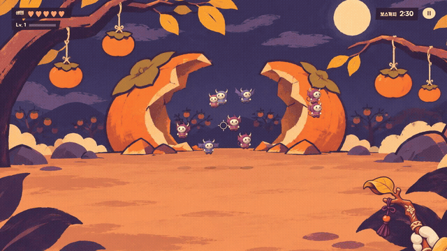

# Yonder

Nilo is a personal AI partner that lives on your desk in mixed reality (Meta Quest 3 / 3S), passes its body through your **real monitor** at the spot you point to, works inside your real Windows desktop as an independent transparent character, and comes back out the same way.

Look at a real cup on your desk and say **“Hey, Nilo, do you see a cup on my desk?”** Quest uses its passthrough camera and the companion identifies the cup locally. To make a textured 3D copy, connect your Tripo key and say **“Hey, Nilo, copy this cup.”** The copy goes into your bag. Say **“Put it on my desk”** to place it in your room or **“Export it as a GLB”** to save the same model on your computer. [Set the Windows Tripo key](tools/Set-TripoKey.ps1) · [Mac setup](Companion/LivingPartner.Mac/README.md)

Say **“Hey, Nilo”** to get Nilo’s attention. To farm, say **“Hey, Nilo, open the star garden.”** Pinch soil to sow, pinch again to water, and harvest golden stars to install Rain Bell, Sun Dial and Twin Bloom in the garden.

Entry for the Meta VR Start Developer Competition 2026 (Productivity). On Windows and Mac, **Demon Gate** is a solo desktop game with mouse controls, 3D demons and a choice of charms. **Gomoku** is a separate game for two people at one TV. The Quest wearer places black stones with a pinch, then looks toward the other player's outstretched finger as they select a white stone on the same board. Tennis and Goalkeeper send the ball between the room and the screen. On MacBook, the companion hosts these games and connects directly to Quest. [MacBook setup and play guide](Companion/LivingPartner.Mac/README.md)

To play Demon Gate on Windows, double-click `dist/Play-Demon-Gate.cmd`. On Mac, open `Start-Yonder.command` and select **Demon Gate · Play solo**.

[Watch the three-minute Yonder walkthrough](Movie/Yonder%20-%20Three%20Minute%20Walkthrough.mp4) · [Film it with a headset and TV](Movie/Yonder%20Filming%20Guide.md).

[Watch the Windows gameplay recording](reports/DEMON_GATE_GAMEPLAY.mp4) · [Boss fight](reports/DEMON_GATE_SOLO.jpg) · [Choose a charm](reports/DEMON_GATE_CHARMS.jpg) · [TV Gomoku after eight moves](reports/GOMOKU_PLAY.png).



Custom game design, scripting and AI playtest review use Claude Fable 5.2. Set `ANTHROPIC_API_KEY` in the Windows or Mac companion's environment and restart it. The Mac companion also reads the `LivingPartner.Anthropic` generic password from Keychain. Playing an installed game runs locally. [Anthropic model and access details](https://platform.claude.com/docs/en/models/fable-5-2/overview)

| Read | For |
|---|---|
| `RUNBOOK.md` | start, pair, calibrate, use, debug, build |
| `reports/DEVICE_AUDIT_KO.md` | Current game, camera and device checks, followed by earlier workshop checks |
| `ARCHITECTURE.md` | how the two renderers show one body |
| `REQUIREMENTS.md` | the requirement list and where each item lives |
| `TEST_RESULTS.md` | what was actually verified, at which level, with numbers |
| `BLOCKERS.md` / `NEXT_STEPS.md` | what is blocked and what to do first with a headset |
| `IMPLEMENTATION_STATUS.md` | resume point |
| `reports/FINAL_REPORT.md` (+ `.pdf`) | session summary (Korean) |
| `reports/PROJECT_DESCRIPTION_EN.md`, `reports/DEMO_SCENARIO.md`, `reports/SUBMISSION_CHECKLIST.md` | submission material (drafts) |

```
MetaVRHack/                 Unity 6 project shared by the Quest and Windows clients
  Assets/LivingPartner/
    Scenes/                 Main (Windows entry) · PcCharacter · MrSimulator · QuestMR · CharacterGallery (viewing only)
    Prefabs/                MrCore · Partner · PortalFx · SparkFx · TimerPanel · ProposalCard
    Art/                    meshes and materials; Characters/ = the partner (Tripo/ = the owner's model, as delivered); Fonts/ = the project's own typeface
    Shared · Character · MR · Quest · Windows · Editor    scripts (one assembly each)
Companion/
  LivingPartner.Host/       .NET 8 companion: authority, launcher, tray
  LivingPartner.Ctl/        lpctl: diagnostics and portal debug
  LivingPartner.Mac/        standalone Mac companion and TV stage (Apple Silicon and Intel)
  LivingPartner.Tests/      tests for the shared core and companion behavior
samples/sample-site/        reviewer sample project
tools/                      launch, verification and evidence scripts
artifacts/                  screenshots, recordings and logs collected in the session
dist/                       built outputs (not committed)
```

The Unity client uses scenes and prefabs for Nilo and the interface. Star Garden creates the three pots, plants and upgrade signs when the garden first opens. Open `PcCharacter.unity`, `MrSimulator.unity` or `QuestMR.unity` to inspect or edit it.

The partner is the owner's own character: a model generated with Tripo from a reference image (`Art/Characters/Tripo`), which the project rigs itself - `Editor/PartnerModelBuilder.cs` skins it to the shared skeleton, separates the eyes so they can blink, and prepares it for being cut by the screen (`artifacts/partner-pose-sheet.png`, `artifacts/partner-cut-sheet.png`). The UI is set in "LPStory", a rounded typeface drawn stroke by stroke by `Editor/StoryFontBuilder.cs` (`artifacts/font-specimen.png`). The licence terms of the generated model are the owner's to check before submission (`reports/SUBMISSION_CHECKLIST.md`).

Two things it does besides the portal and the coding work (RUNBOOK §4.1, §4.2): asked what it thinks of the window you point at, it looks, tells you, and saves a marked-up capture, a redrawn revised version (PNG) and a PDF of the review on the PC - and it reads PDF, picture and text files and can answer questions about them afterwards; and it plays tennis with you through the monitor - it plays in a court inside the screen, its ball comes out into the room, and your open hand is the racket.
Quick start on the PC: double-click `Start-Yonder.cmd`. Without a headset: `tools\Start-Dev.ps1 -Sim -LoopbackOnly` runs the desktop MR simulator (a verification tool, not a Quest).
